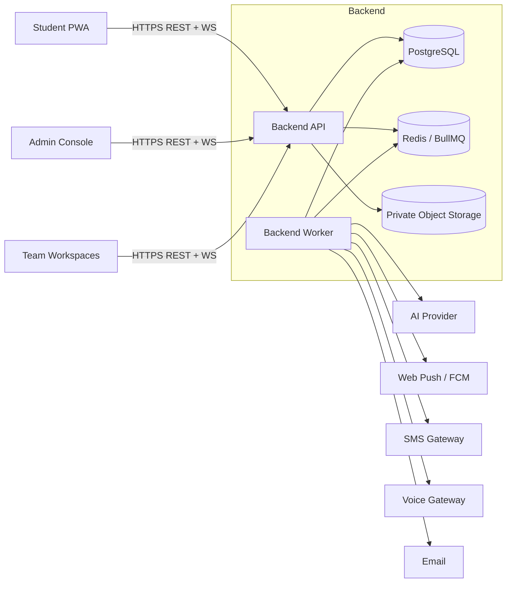
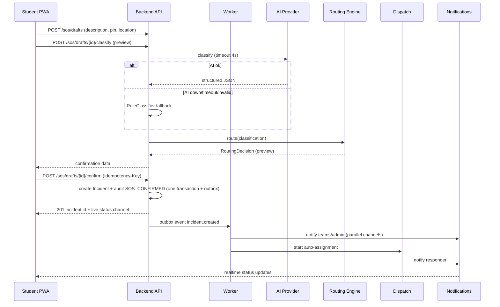
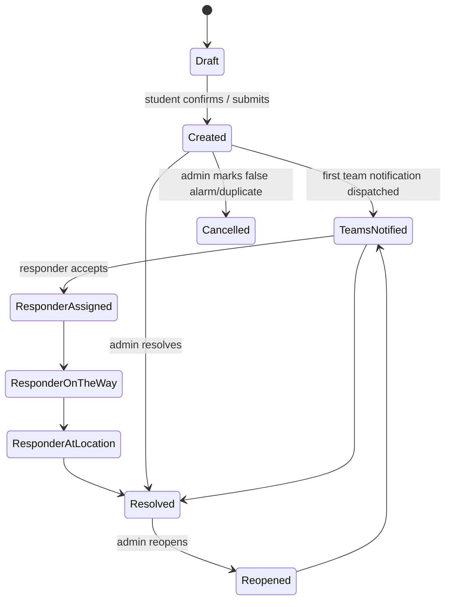
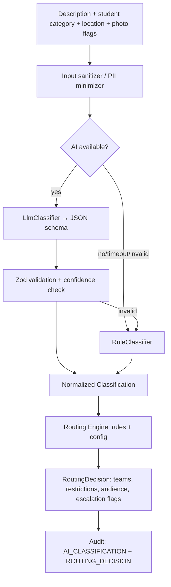

# Campus SOS — System Architecture

## 1. Architectural Goals
1. Emergency path stays operational when any single external service or responder fails.
2. Strict frontend/backend separation with documented contracts.
3. AI structures; deterministic rules route; humans respond.
4. Least-privilege access with auditable exceptions.
5. A second developer can find any concern in minutes.

## 2. System Context



## 3. Repository and Module Map

```
campus-sos/
├── frontend/              # Independent application (React PWA)
│   └── src/
│       ├── design-system/ # Tokens + components (built from scratch)
│       ├── shell/         # Auth guard, role router, offline, push
│       ├── features/
│       │   ├── student/   # home, sos, assist, report, explore, my-reports, notifications, contacts
│       │   ├── admin/     # overview, incidents, dispatch, resolved, map, teams, responders, directory, analytics, notifications, audit, settings
│       │   ├── proctor/ security/ medical/ fire/ women-safety/ men-safety/
│       │   └── council/ facilities/ transport/ digital/
│       ├── api-client/    # Generated from contracts/openapi.yaml
│       └── realtime/      # Socket client, event typings
├── backend/               # Independent application (NestJS)
│   └── src/
│       ├── modules/
│       │   ├── auth/            # login, MFA, tokens, sessions
│       │   ├── users/ teams/    # personnel, memberships, responders
│       │   ├── incidents/       # lifecycle, status machine
│       │   ├── attachments/     # photo upload/storage/access
│       │   ├── locations/       # map, predefined locations, pins
│       │   ├── ai/              # classifier interface, LLM + rule fallback
│       │   ├── routing/         # deterministic engine, rule config
│       │   ├── dispatch/        # responder selection, timers, escalation
│       │   ├── notifications/   # audience, channels, deliveries, inbox
│       │   ├── realtime/        # gateways, subscription auth
│       │   ├── explore/         # sanitized public view
│       │   ├── analytics/       # response metrics
│       │   ├── audit/           # append-only audit writer/reader
│       │   ├── settings/        # hotlines, map, timeouts, rules
│       │   └── access-policy/   # RBAC + team + incident-level decisions
│       ├── worker.ts            # queue consumers
│       └── database/            # migrations, schema
├── contracts/             # openapi.yaml, json-schemas/, events/
└── docs/                  # This package
```

Each backend module exposes: `*.controller.ts` (HTTP), `*.service.ts` (domain), `*.repository.ts` (DB), `dto/`, `events/`. Modules may depend on `access-policy`, `audit`, and published interfaces of other modules only.

## 4. Component Responsibilities
| Component | Responsibility |
|---|---|
| Student PWA | SOS/report capture, map pin, photos, live status, notifications |
| Role workspaces | Case handling for each role with role-specific UI |
| Backend API | Authentication, authorization, validation, orchestration |
| Worker | Classification, routing, dispatch timers, notification fan-out, retries |
| Routing engine | Pure deterministic function: `(classification, context, config) → RoutingDecision` |
| Dispatch engine | Select responders by team, availability, load, fairness; handle timeouts |
| Notification service | Resolve audiences, apply privacy filters, send over channels, record receipts |
| Audit service | Append-only event writer; timeline reader |
| Realtime gateway | Push status/dispatch/notification events to authorized subscribers |

## 5. Incident Creation Data Flow



Key rule: the **confirm** transaction never calls an external service. Classification is computed beforehand (preview) or recomputed in the worker if absent.

## 6. State Machines

### 6.1 Incident status

Student-facing live statuses map 1:1: *Emergency Created, Teams Notified, Responder Assigned, Responder On the Way, Responder At Location, Resolved*. Internal extras (Reopened, Cancelled/False Alarm, Escalated) are shown to students in neutral wording.

### 6.2 Assignment
`Offered → Accepted | Rejected | TimedOut | Cancelled`; `Accepted → EnRoute → OnScene → Completed`.

### 6.3 Responder availability
`Available ⇄ Busy`, `Available/Busy → Offline`, `Offline → Available`. Transitions: assignment accepted → Busy; assignment completed/cancelled → Available (if on duty); explicit toggle by responder/admin; duty schedule. **Never** by inactivity.

## 7. Authorization Architecture

### 7.1 Layers
1. **Authentication** — JWT subject, session validity, MFA level.
2. **RBAC** — user's role(s).
3. **Team-based authorization** — team memberships and `can_view_restricted` flags.
4. **Incident-level access** — `incident_access` grants (derived from routing/assignment) + explicit admin grants.
5. **Field-level filtering** — response serializers strip fields (reporter identity, AI reasoning) per audience.
6. **DB row-level security** — defense-in-depth.

### 7.2 Access decision (pseudo)
```
canViewIncident(user, incident):
  if user.role == CAMPUS_ADMIN: allow (audit if incident.restricted)
  if incident.reporter_id == user.id: allow (reporter view)
  if exists incident_access where team_id in user.teams and revoked_at is null: allow
  if exists assignment where responder_id == user.id: allow
  deny
`canViewPhotos` = reporter, assigned team, admin, or active break-glass with `EVIDENCE_VIEW`.
`canViewReporterContact` = reporter, admin, or active break-glass with `REPORTER_CONTACT_VIEW`.
`canModifyIncident` = admin, ACT team, or active break-glass with `INCIDENT_UPDATE`.
`hasRealtimeAccess` = reporter, assigned team, admin, or active break-glass with `REALTIME_ACCESS`. Chief Proctor receives access only when routing or break-glass grants it.

### 7.3 Role capability matrix (summary)
| Capability | Student | Admin | Proctor | Security | Medical | Fire | Women/Men Safety | Council | Facilities | Transport | IT |
|---|---|---|---|---|---|---|---|---|---|---|---|
| Create SOS/report | ✔ | ✔* | – | – | – | – | – | – | – | – | – |
| View all incidents | – | ✔ | – | – | – | – | – | – | – | – | – |
| View routed incidents | own | ✔ | ✔ | ✔ | ✔ | ✔ | ✔ | ✔ | ✔ | ✔ | ✔ |
| Change status | – | ✔ | ✔ | ✔ | ✔ | ✔ | ✔ | ✔ | ✔ | ✔ | ✔ |
| Manage teams/settings | – | ✔ | – | – | – | – | – | – | – | – | – |
| Approve campus-wide notice | – | ✔ | – | – | – | – | – | – | – | – | – |
| View audit trail | own timeline | ✔ | case only | case only | case only | case only | case only | case only | case only | case only | case only |
\* Admin may create an incident on behalf of a caller (audited `created_by_admin`).

### 7.4 Emergency Access / Break-Glass Architecture
- **Purpose**: Exceptional temporary cross-team authorization during serious incidents without permanent role/roster mutation.
- **Workflow Modes**:
  - `NORMAL_OVERRIDE`: Requires explicit approval from authorized supervisor or coordinator. Default duration 60m.
  - `CRITICAL_BREAK_GLASS`: Immediate activation when delays create life-safety risk. Short expiry (30m). Mandatory post-hoc supervisor review (`REVIEW_REQUIRED` → `REVIEWED`).
- **Granular Scopes**: `INCIDENT_VIEW`, `LOCATION_VIEW`, `EVIDENCE_VIEW`, `REPORTER_CONTACT_VIEW`, `REALTIME_ACCESS`, `INCIDENT_UPDATE`, `TEMPORARY_TEAM_ASSIGNMENT`.
- **Enforcement**: Layered in `AccessPolicyService`. Every grant is time-bound, incident-scoped, revocable, and participates in the SHA-256 tamper-evident audit chain. Background cron worker sweeps and marks expired grants. Sensitive access (evidence, reporter contact) logs separate auditable access events.

## 8. AI and Routing Architecture


- Student-chosen category and AI category are both inputs; the engine unions fired rules.
- Photos are never sent to AI for identification. The `photo_present` boolean and the student's category are the only photo-related inputs.
- The routing decision is stored as an immutable JSON snapshot with the config version.

## 9. Dispatch Architecture

### 9.1 Algorithm
```
for each team in decision.assignment_teams:
  required = decision.responders_required[team] (default 1)
  candidates = team members where duty_state == Available and skills match and not excluded
  order candidates by: (a) skill match, (b) least recent assignment, (c) proximity zone (optional)
  offer to top candidate -> start timer (team.timeout_seconds)
  on Accept: duty_state = Busy; audit RESPONDER_ASSIGNED/ACCEPTED; continue until required satisfied
  on Reject/Timeout: audit; offer to next candidate
  if candidates exhausted before required met:
      escalate: notify team coordinator + Campus Administration; audit ESCALATED
Team-level notification (awareness) is sent to the whole team at start and remains active after assignment.
```
### 9.2 Guarantees
- SOS offers go out in parallel to the top *N* (default 2) candidates for each required slot when `sos_parallel_offer=true`; first accept wins, others are cancelled.
- If the whole dispatch worker is down, a watchdog (cron every 15 s) detects SOS incidents with no `TEAMS_NOTIFIED` and re-enqueues; the admin dispatch page also offers manual assign.
- Responder reassignment (manual or automatic) is audited `REASSIGNED`.
- Offline responders are never auto-selected; Busy responders are excluded unless the team enables `allow_busy_override_for_sos` (default off).

## 10. Notification Architecture

### 10.1 Pipeline
`DomainEvent → AudienceResolver → PrivacyFilter → Template → ChannelPlanner → Sender → DeliveryReceipt → Audit`

### 10.2 Audience types
| Audience | Contents | Recipients |
|---|---|---|
| `ACT` | Full case details they are authorized to see | Assigned responders, team coordinators |
| `KNOW` | Case summary within their authorization | Team awareness, Chief Proctor (when routed), Campus Administration |
| `REPORTER` | Status progress | Reporting student |
| `CAMPUS_WIDE` | **Sanitized** safety notice | All logged-in users with notifications enabled |
| `AREA` | Sanitized notice for an area avoidance | All logged-in users (optionally filtered by hostel/block subscriptions) |

### 10.3 Campus-wide eligibility and approval
- Eligible categories (default): major fire, major fire hazard, major route blockage, major security threat, campus-wide safety danger, major environmental/safety hazard, event requiring area avoidance.
- **Never eligible:** teacher/student misconduct, harassment, individual medical case, personal grievance, student-teacher dispute, disciplinary matter (hard-coded deny list that settings cannot override).
- Flow: rule marks `campus_wide_eligible=true` → system generates a sanitized draft from a fixed template (no free text from the student) → Campus Administration approves/edits → publish. `auto_publish_categories` (default empty) can skip approval.
- Sanitization strips: reporter identity, names, photos, medical details, exact description.

### 10.4 Visibility matrix (Explore and notices)
| Incident class | Student (not reporter) | Reporter | Assigned team | Admin |
|---|---|---|---|---|
| Public-safe major hazard (approved notice) | Sanitized | Own view | Full | Full |
| Standard non-sensitive (e.g., infrastructure) | Sanitized pin + status only if admin marks `explore_visible` | Own | Full | Full |
| Restricted/sensitive (misconduct, harassment, medical, grievance) | Hidden | Own | Full (routed teams only) | Full (audited) |

### 10.5 Channel redundancy
| Event | Channels (in order, parallel where noted) |
|---|---|
| SOS to responder | Push + SMS in parallel; voice call after timeout/no-ack |
| SOS to team | Push + in-app |
| SOS to admin | Push + in-app + SMS |
| Standard to team | In-app + push |
| Campus-wide | In-app + push (+ SMS only for admin-flagged critical) |
Failures retry with backoff; failure reasons stored; persistent failure raises an admin alert.

## 11. Realtime Architecture
- Gateways: `IncidentGateway`, `DispatchGateway`, `NotificationGateway`.
- Student subscribes to `incident:{id}` for own incidents; teams to `team:{id}`; admin to `admin:dispatch`.
- Every subscribe call runs `AccessPolicy`. Event payloads are filtered per audience.
- Reconnect: client sends last event sequence; server replays missed events (kept 24 h in Redis stream).

## 12. Resilience Matrix
| Failure | Behaviour |
|---|---|
| AI down / slow / invalid | RuleClassifier; routing proceeds; audit note `AI_FALLBACK_USED` |
| Push down | SMS + in-app |
| SMS down | Push + voice |
| Voice down | Push + SMS + admin alert |
| Redis down | API writes outbox in Postgres; worker polls outbox directly (degraded) |
| Worker down | Watchdog + admin manual dispatch page + health alert |
| Object storage down | Incident created without photos; student told photos pending; retry upload |
| Primary responder rejects/ignores | Next candidate → coordinator → admin |
| Whole team unavailable | Escalate to Campus Administration; Security always added for SOS where routing says so |
| Student offline | Local queue + hotline buttons |

## 13. Security Architecture
- TLS everywhere; HSTS; CSP; CSRF protection for cookie flows; strict CORS to the frontend origin.
- Secrets in a secrets manager; key rotation.
- Input validation (Zod) at the boundary; output encoding; upload scanning.
- Rate limits: SOS drafts and reports per user; login attempts; photo uploads.
- Audit: append-only; admin export; tamper-evident hash chain on `audit_events` (`prev_hash`, `hash`).
- Privacy: field-level filtering; data minimization in AI prompts; log redaction.
- Sensitive photo access is audited (`PHOTO_VIEWED`).

## 14. Data Architecture Summary
Core tables: users, roles, teams, team_members, responders (duty state), incidents, incident_locations (pin), attachments, ai_classifications, routing_decisions, incident_teams (access), assignments, notifications, notification_deliveries, incident_status_history, audit_events, campus_maps, predefined_locations, hotlines, settings, routing_rules. Full detail in `DATABASE_SCHEMA.md`.

## 15. Scalability and Deployment Topology
- Stateless API behind a reverse proxy; scale horizontally.
- Worker scaled by queue depth; separate queues: `sos-critical`, `standard`, `notifications`, `analytics`.
- Postgres primary + read replica (optional) for analytics.
- Campus-scale load is modest; the priority is reliability, not throughput.

## 16. Environments and Dev-Only Tools
| Environment | Role switcher | Mock adapters | Real data |
|---|---|---|---|
| dev | Enabled | AI/SMS/push mocks | None seeded |
| staging | Disabled | Sandbox providers | No real accounts |
| production | Disabled (build fails if present) | None | Created in final phase |

## 17. Architecture Decision Records (summary)
| ADR | Decision |
|---|---|
| 001 | Separate frontend/backend repos or folders with OpenAPI contract |
| 002 | AI outputs structured JSON only; routing is pure and deterministic |
| 003 | Normalized pin coordinates `[0,1]` |
| 004 | Append-only hash-chained audit |
| 005 | Union-of-rules routing when student and AI categories differ |
| 006 | Campus-wide notices require Administration approval by default |
| 007 | No inactivity auto-offline |
