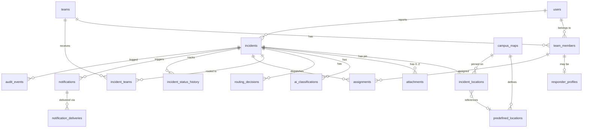

# Campus SOS — Database Schema

PostgreSQL 16. Conventions: UUID v7 primary keys (`id uuid`), `timestamptz` for all times (UTC), snake_case, soft-delete only where stated, `created_at`/`updated_at` on mutable tables. **No seed data** is included in foundational migrations except enum/lookup values and default configuration (no fake users, incidents, statistics, notifications, or audit records).

## 1. Entity Relationship Overview

## 2. Enumerations

| Enum | Values |
|---|---|
| `user_role` | `STUDENT`, `CAMPUS_ADMIN`, `CHIEF_PROCTOR`, `SECURITY`, `MEDICAL`, `FIRE_SAFETY`, `WOMEN_SAFETY`, `MEN_SAFETY`, `STUDENT_COUNCIL`, `INFRASTRUCTURE`, `TRANSPORTATION`, `IT_DIGITAL` |
| `user_type` | `student`, `staff`, `personnel` |
| `workflow_type` | `EMERGENCY_SOS`, `STANDARD_REPORT` |
| `incident_status` | `DRAFT`, `CREATED`, `TEAMS_NOTIFIED`, `RESPONDER_ASSIGNED`, `RESPONDER_ON_THE_WAY`, `RESPONDER_AT_LOCATION`, `RESOLVED`, `REOPENED`, `CANCELLED` |
| `duty_state` | `AVAILABLE`, `BUSY`, `OFFLINE` |
| `assignment_status` | `OFFERED`, `ACCEPTED`, `REJECTED`, `TIMED_OUT`, `CANCELLED`, `EN_ROUTE`, `ON_SCENE`, `COMPLETED` |
| `location_kind` | `ROOM`, `CLASSROOM`, `LABORATORY`, `BLOCK`, `LIBRARY`, `CANTEEN`, `PARKING`, `GROUND`, `HOSTEL`, `OTHER` |
| `incident_category` | See `AI_ROUTING_SPECIFICATION.md` §3 (taxonomy codes) |
| `class_source` | `AI`, `RULE_FALLBACK`, `STUDENT`, `ADMIN_OVERRIDE` |
| `audience_type` | `ACT`, `KNOW`, `REPORTER`, `CAMPUS_WIDE`, `AREA` |
| `channel` | `IN_APP`, `PUSH`, `SMS`, `VOICE`, `EMAIL` |
| `delivery_status` | `QUEUED`, `SENT`, `DELIVERED`, `READ`, `FAILED`, `SKIPPED` |
| `notice_status` | `DRAFT`, `PENDING_APPROVAL`, `PUBLISHED`, `REJECTED`, `WITHDRAWN` |
| `audit_event_type` | `INCIDENT_CREATED`, `SOS_CONFIRMED`, `AI_CLASSIFICATION`, `ROUTING_DECISION`, `NOTIFICATION_SENT`, `RESPONDER_ASSIGNED`, `RESPONDER_ACCEPTED`, `RESPONDER_REJECTED`, `REASSIGNED`, `STATUS_CHANGED`, `RESOLVED`, `ADMIN_ACTION`, `TEAM_ASSIGNMENT_CHANGED`, `ACCESS_EVENT`, `ACCESS_RESTRICTED_CASE`, `PHOTO_VIEWED`, `AI_FALLBACK_USED`, `ESCALATED`, `DUTY_STATE_CHANGED`, `BREAK_GLASS_REQUESTED`, `BREAK_GLASS_APPROVED`, `BREAK_GLASS_REJECTED`, `BREAK_GLASS_ACTIVATED`, `BREAK_GLASS_EXPIRED`, `BREAK_GLASS_REVOKED`, `BREAK_GLASS_REVIEW_REQUIRED`, `BREAK_GLASS_REVIEWED` |
| `break_glass_scope` | `INCIDENT_VIEW`, `LOCATION_VIEW`, `EVIDENCE_VIEW`, `REPORTER_CONTACT_VIEW`, `REALTIME_ACCESS`, `INCIDENT_UPDATE`, `TEMPORARY_TEAM_ASSIGNMENT` |
| `break_glass_status` | `REQUESTED`, `APPROVED`, `ACTIVE`, `EXPIRED`, `REVOKED`, `REJECTED`, `REVIEW_REQUIRED`, `REVIEWED` |
| `break_glass_type` | `NORMAL_OVERRIDE`, `CRITICAL_BREAK_GLASS` |
| `supervisor_review_status` | `NOT_REQUIRED`, `REVIEW_REQUIRED`, `REVIEWED`, `FLAGGED` |

## 3. Tables

### 3.1 `users`
| Column | Type | Constraints / Notes |
|---|---|---|
| id | uuid | PK |
| user_type | user_type | NOT NULL |
| role | user_role | NOT NULL (primary role) |
| full_name | text | NOT NULL |
| email | citext | UNIQUE, NOT NULL |
| phone | text | NULL; E.164; **visible only to admin/personnel directory for personnel rows** |
| password_hash | text | NULL if SSO-only |
| sso_subject | text | UNIQUE NULL |
| mfa_enabled | boolean | default false (required true for non-students by policy) |
| notifications_enabled | boolean | default true |
| is_active | boolean | default true |
| last_login_at | timestamptz | NULL |
| created_at / updated_at | timestamptz | |
Indexes: `(role)`, `(user_type)`, unique `(email)`.
Rule: student phone numbers are optional private profile data; **no API lists students' phones** (PRD §14).

### 3.2 `teams`
| Column | Type | Notes |
|---|---|---|
| id | uuid | PK |
| code | text | UNIQUE (`SECURITY`, `MEDICAL`, `FIRE_SAFETY`, `CHIEF_PROCTOR`, `WOMEN_SAFETY`, `MEN_SAFETY`, `STUDENT_COUNCIL`, `INFRASTRUCTURE`, `TRANSPORTATION`, `IT_DIGITAL`, `CAMPUS_ADMIN`) |
| name | text | Display name |
| is_restricted | boolean | true for Women/Men Safety |
| is_enabled | boolean | default true (Student Council "when configured") |
| assignment_mode | text | `AUTO_ASSIGN` \| `TEAM_QUEUE` |
| offer_timeout_sos_seconds | int | default 45 |
| offer_timeout_standard_seconds | int | default 600 |
| sos_parallel_offer | boolean | default true |
| allow_busy_override_for_sos | boolean | default false |
| coordinator_member_id | uuid | FK `team_members.id` NULL |

### 3.3 `team_members`
| Column | Type | Notes |
|---|---|---|
| id | uuid | PK |
| team_id | uuid | FK teams, NOT NULL |
| user_id | uuid | FK users, NOT NULL |
| designation | text | e.g., "Duty Doctor" |
| is_coordinator | boolean | default false |
| can_view_restricted | boolean | default false (team-level restricted access) |
| is_directory_visible | boolean | default true |
| joined_at / left_at | timestamptz | |
Constraints: UNIQUE `(team_id, user_id)`. Index `(user_id)`, `(team_id)`.

### 3.4 `responder_profiles`
| Column | Type | Notes |
|---|---|---|
| member_id | uuid | PK, FK team_members |
| duty_state | duty_state | NOT NULL default `OFFLINE` |
| duty_state_changed_at | timestamptz | |
| duty_state_changed_by | uuid | FK users (self/admin/system-schedule) |
| change_reason | text | `SELF`, `ADMIN`, `SCHEDULE`, `ASSIGNMENT`, `COMPLETION` — never `INACTIVITY` (CHECK constraint) |
| skills | text[] | e.g., `{first_aid, fire_extinguisher}` |
| last_assigned_at | timestamptz | fairness ordering |
| current_assignment_count | int | default 0 |
| push_subscription_ids | uuid[] | |
| sms_phone | text | |
CHECK: `change_reason <> 'INACTIVITY'`.
Index: `(duty_state)`.

### 3.5 `duty_schedules`
`id`, `member_id` FK, `starts_at`, `ends_at`, `recurrence` (RRULE text, NULL), `created_by`. Used only for scheduled Available/Offline transitions (A-11).

### 3.6 `campus_maps`
| Column | Type | Notes |
|---|---|---|
| id | uuid | PK |
| name | text | |
| storage_key | text | object key of the static 2D image |
| width_px / height_px | int | natural image size |
| is_active | boolean | one active map in v1 (partial unique index) |
| uploaded_by | uuid | FK users |
| created_at | timestamptz | |

### 3.7 `predefined_locations`
| Column | Type | Notes |
|---|---|---|
| id | uuid | PK |
| map_id | uuid | FK campus_maps |
| kind | location_kind | NOT NULL |
| name | text | e.g., "Block C — Lab 3" |
| anchor_x / anchor_y | numeric(7,6) | NULL; CHECK 0..1; suggestion only |
| is_active | boolean | |
Index: `(map_id, kind)`.

### 3.8 `incidents`
| Column | Type | Notes |
|---|---|---|
| id | uuid | PK |
| public_id | text | UNIQUE, e.g., `SOS-2027-000123`, `INC-2027-000456` |
| workflow | workflow_type | NOT NULL |
| reporter_id | uuid | FK users NOT NULL |
| created_by_id | uuid | FK users (reporter or admin proxy) |
| description | text | NOT NULL; **full student text** |
| student_category | incident_category | NULL for SOS (student does not pick) |
| final_category | incident_category | NOT NULL after classification (default `OTHER`) |
| status | incident_status | NOT NULL |
| is_restricted | boolean | derived from routing (sensitive/restricted) |
| immediate_danger | boolean | from classification/rules |
| campus_wide_eligible | boolean | |
| explore_visible | boolean | default false |
| confirmed_at | timestamptz | SOS confirmation time (NULL for standard) |
| created_at | timestamptz | |
| first_team_notified_at | timestamptz | T1 |
| first_accepted_at | timestamptz | T2 |
| responder_arrived_at | timestamptz | T3 |
| resolved_at | timestamptz | T4 |
| resolution_summary | text | |
| resolution_code | text | `RESOLVED`, `FALSE_ALARM`, `DUPLICATE`, `REFERRED` |
| idempotency_key | text | UNIQUE per reporter |
| is_drill | boolean | default false (synthetic probes; excluded from analytics) |
Indexes: `(status)`, `(workflow, status)`, `(final_category)`, `(reporter_id, created_at desc)`, `(created_at desc)`, partial `(status) WHERE workflow='EMERGENCY_SOS' AND status<>'RESOLVED'`.
CHECK: `workflow='EMERGENCY_SOS' → student_category IS NULL` (no student priority/category choice for SOS).

### 3.9 `incident_drafts`
`id`, `reporter_id`, `workflow`, `payload jsonb` (description, pin, location, attachment ids), `classification_preview jsonb`, `routing_preview jsonb`, `expires_at`. Drafts are **not** incidents; auto-purged after 24 h.

### 3.10 `incident_locations`
| Column | Type | Notes |
|---|---|---|
| incident_id | uuid | PK, FK incidents |
| map_id | uuid | FK campus_maps |
| predefined_location_id | uuid | FK NULL |
| location_kind | location_kind | NULL allowed only for SOS fast-path; required for standard (CHECK via trigger) |
| location_text | text | free text detail (e.g., "Room 204") |
| pin_x | numeric(7,6) | NOT NULL for standard; NULL allowed for SOS fast-path; CHECK 0..1 |
| pin_y | numeric(7,6) | same |
| gps_lat / gps_lng | numeric(9,6) | optional hint only |

### 3.11 `attachments`
| Column | Type | Notes |
|---|---|---|
| id | uuid | PK |
| incident_id | uuid | FK (nullable for draft uploads until linked) |
| draft_id | uuid | FK NULL |
| uploader_id | uuid | FK users |
| storage_key | text | private object key |
| mime_type | text | `image/jpeg`, `image/png`, `image/webp`, `image/heic`→converted |
| size_bytes | int | ≤ 10 MB |
| width_px / height_px | int | |
| sha256 | text | |
| scan_status | text | `PENDING`, `CLEAN`, `REJECTED` |
| position | smallint | 1 or 2 |
| created_at | timestamptz | |
Constraints: CHECK `position IN (1,2)`; UNIQUE `(incident_id, position)`; trigger rejects a third attachment (**maximum 2 photos**). No public URL column.

### 3.12 `ai_classifications`
| Column | Type | Notes |
|---|---|---|
| id | uuid | PK |
| incident_id | uuid | FK |
| source | class_source | `AI` or `RULE_FALLBACK` |
| model / prompt_version | text | |
| input_snapshot | jsonb | minimized input |
| output | jsonb | validated structured output (see AI spec §4) |
| category | incident_category | |
| confidence | numeric(4,3) | |
| immediate_danger | boolean | |
| reasoning | text | visible only to authorized personnel |
| latency_ms | int | |
| created_at | timestamptz | |
Index: `(incident_id, created_at desc)`.

### 3.13 `routing_decisions`
| Column | Type | Notes |
|---|---|---|
| id | uuid | PK |
| incident_id | uuid | FK |
| classification_id | uuid | FK |
| config_version | int | routing rules version |
| matched_rules | text[] | rule IDs |
| teams | jsonb | `[{team_code, reason, required_responders, role: "ACT"|"KNOW"}]` |
| restrictions | jsonb | `{restricted, hide_reporter_from_teams, no_campus_wide}` |
| audience | jsonb | `{campus_wide_eligible, notices:[…]}` |
| flags | text[] | `CATEGORY_MISMATCH`, `AI_FALLBACK`, `ESCALATE_ADMIN` |
| created_at | timestamptz | |

### 3.14 `incident_teams` (incident-level access + team awareness)
| Column | Type | Notes |
|---|---|---|
| incident_id | uuid | FK |
| team_id | uuid | FK |
| role | text | `ACT` or `KNOW` |
| granted_by | text | `ROUTING`, `ADMIN` |
| granted_at | timestamptz | |
| revoked_at | timestamptz | NULL while active |
PK `(incident_id, team_id)`. Index `(team_id, revoked_at)`.

### 3.15 `assignments`
| Column | Type | Notes |
|---|---|---|
| id | uuid | PK |
| incident_id | uuid | FK |
| team_id | uuid | FK |
| member_id | uuid | FK team_members |
| status | assignment_status | |
| offered_at | timestamptz | |
| responded_at | timestamptz | |
| expires_at | timestamptz | offer deadline |
| accepted_at / en_route_at / on_scene_at / completed_at | timestamptz | |
| reject_reason | text | |
| attempt_no | int | order within slot |
| slot_no | int | for multi-responder |
| assigned_by | text | `AUTO`, `ADMIN`, `COORDINATOR` |
Indexes: `(incident_id)`, `(member_id, status)`, `(status, expires_at)` for timers.
Unique partial: one active assignment per `(incident_id, member_id)`.

### 3.16 `incident_status_history`
`id`, `incident_id`, `from_status`, `to_status`, `changed_by` (user or `SYSTEM`), `note`, `created_at`. Index `(incident_id, created_at)`.

### 3.17 `notifications`
| Column | Type | Notes |
|---|---|---|
| id | uuid | PK |
| incident_id | uuid | FK NULL (for general notices) |
| audience_type | audience_type | |
| recipient_user_id | uuid | FK NULL for broadcasts |
| notice_id | uuid | FK campus_notices NULL |
| title / body | text | already privacy-filtered |
| payload | jsonb | deep link, ids |
| created_at | timestamptz | |
| read_at | timestamptz | per-recipient inbox |
Index `(recipient_user_id, created_at desc)`, `(incident_id)`.

### 3.18 `notification_deliveries`
`id`, `notification_id`, `channel`, `status`, `provider_message_id`, `attempt`, `error_code`, `sent_at`, `delivered_at`. Index `(notification_id)`, `(status)`.

### 3.19 `campus_notices` (campus-wide/area notices)
`id`, `incident_id` FK NULL, `status notice_status`, `title`, `sanitized_body`, `area_text`, `starts_at`, `ends_at`, `drafted_by` (`SYSTEM`/user), `approved_by`, `approved_at`, `auto_published boolean`, `category`. Constraint: category must **not** be a category flagged `deny_campus_wide = true` in the taxonomy (`AI_ROUTING_SPECIFICATION.md` §3: e.g., `TEACHER_MISCONDUCT`, `STUDENT_MISCONDUCT`, `STUDENT_TEACHER_DISPUTE`, `HARASSMENT_WOMEN`, `HARASSMENT_MEN`, `MEDICAL_EMERGENCY`, `ACCIDENT`, `FIGHT_QUARREL`, `GRIEVANCE_WELFARE`, `DISCIPLINARY_OTHER`) — enforced by CHECK against the `incident_category_flags` lookup + service rule.

### 3.20 `routing_rules`
`id`, `rule_id` (e.g., `R-FIRE-001`), `version`, `enabled`, `priority`, `condition jsonb`, `actions jsonb`, `description`, `updated_by`. Versioned; every change audited `ADMIN_ACTION`.

### 3.21 `hotlines`
`id`, `label`, `phone`, `description`, `sort_order`, `is_24x7 boolean`, `is_active`. Configurable 24/7 campus emergency contacts (no seeded numbers).

### 3.22 `settings`
Key/value `jsonb` with `updated_by`, `updated_at`: timeouts, `auto_publish_categories`, retention, AI enable flag, notification channel config.

### 3.23 `audit_events` (append-only)
| Column | Type | Notes |
|---|---|---|
| id | bigserial | PK |
| occurred_at | timestamptz | NOT NULL default now() |
| event_type | audit_event_type | NOT NULL |
| incident_id | uuid | NULL |
| actor_user_id | uuid | NULL for SYSTEM |
| actor_kind | text | `USER`, `SYSTEM`, `AI`, `WORKER` |
| target_type / target_id | text / text | |
| details | jsonb | before/after, reasons |
| ip_address | inet | |
| prev_hash / hash | bytea | hash chain |
Permissions: application role has `INSERT, SELECT` only; `UPDATE/DELETE/TRUNCATE` revoked; trigger blocks modification. Indexes `(incident_id, occurred_at)`, `(event_type, occurred_at)`.

### 3.24 `push_subscriptions`
`id`, `user_id`, `endpoint`, `keys jsonb`, `platform`, `created_at`, `last_seen_at`.

### 3.25 `sessions` / `refresh_tokens`
`id`, `user_id`, `token_hash`, `device_info`, `expires_at`, `revoked_at`, `rotated_from`.

### 3.26 `break_glass_requests`
| Column | Type | Constraints / Notes |
|---|---|---|
| id | uuid | PK |
| incident_id | uuid | FK -> `incidents.id` |
| requester_user_id | uuid | FK -> `users.id` |
| requester_team_context | text | Requester's operational team/role |
| type | break_glass_type | `NORMAL_OVERRIDE` or `CRITICAL_BREAK_GLASS` |
| status | break_glass_status | `REQUESTED`, `APPROVED`, `ACTIVE`, `EXPIRED`, `REVOKED`, `REJECTED`, `REVIEW_REQUIRED`, `REVIEWED` |
| requested_scopes | break_glass_scope[] | Granular requested access scopes |
| approved_scopes | break_glass_scope[] | Scopes authorized by approver |
| reason | text | Emergency justification |
| requested_at | timestamptz | NOT NULL, default NOW() |
| approver_user_id | uuid | FK -> `users.id`, NULL for self-activated critical |
| approved_at | timestamptz | Timestamp of approval |
| activated_at | timestamptz | Timestamp of access grant activation |
| expires_at | timestamptz | Backend-enforced expiry timestamp |
| revoker_user_id | uuid | FK -> `users.id`, user who revoked grant |
| revoked_at | timestamptz | Timestamp of revocation |
| revocation_reason | text | Revocation justification |
| rejected_at | timestamptz | Timestamp of rejection |
| rejection_reason | text | Rejection justification |
| supervisor_review_status | supervisor_review_status | `NOT_REQUIRED`, `REVIEW_REQUIRED`, `REVIEWED`, `FLAGGED` |
| reviewer_user_id | uuid | FK -> `users.id`, reviewing supervisor |
| reviewed_at | timestamptz | Timestamp of supervisor review |
| review_notes | text | Supervisor review rationale |
| audit_correlation_id | text | Correlation ID linking to audit chain |
| created_at / updated_at | timestamptz | Standard tracking timestamps |
Indexes: `(incident_id, status)`, `(requester_user_id, status)`, `(status, expires_at)`.

## 4. Views and Materialized Views

| View | Purpose |
|---|---|
| `v_incident_admin` | Full case row for admin |
| `v_incident_team` | Incident joined with `incident_teams` for a team (RLS-bound) |
| `v_incident_student` | Reporter-visible fields only |
| `v_explore_public` | Sanitized fields for Explore: public_id, pin, category label (generic), status, time — only `explore_visible` or approved notices |
| `mv_response_metrics` | Pre-aggregated T1–T4 per day/category/team for analytics |

## 5. Row-Level Security (defense in depth)
- `incidents`: SELECT allowed if `current_user_role='CAMPUS_ADMIN'`, or `reporter_id = current_user_id`, or the user's team has an active `incident_teams` row, or the user has an active assignment.
- `attachments`: same predicate through `incident_id`.
- `audit_events`: admin full; others only rows for incidents they can view and only `event_type` in an allowed list (no ACCESS events).
- Application sets `app.user_id`, `app.role` per request/transaction.

## 6. Permissions Matrix (database roles)
| DB role | Access |
|---|---|
| `app_api` | CRUD on operational tables, INSERT/SELECT on `audit_events`; no DDL |
| `app_worker` | Same as API plus updates for deliveries/assignments timers |
| `app_readonly_analytics` | SELECT on `mv_response_metrics` and aggregate views |
| `migration_admin` | DDL only; used by CI/CD |

## 7. Status Reference

| Incident status | Student-facing label | Set by |
|---|---|---|
| CREATED | Emergency Created | System at confirm/submit |
| TEAMS_NOTIFIED | Teams Notified | Notification service after first send |
| RESPONDER_ASSIGNED | Responder Assigned | Dispatch on first accept |
| RESPONDER_ON_THE_WAY | Responder On the Way | Responder |
| RESPONDER_AT_LOCATION | Responder At Location | Responder |
| RESOLVED | Resolved | Responder/team/admin |
| REOPENED | Reopened | Admin |
| CANCELLED | Closed (false alarm / duplicate) | Admin |

## 8. Map Coordinate Storage Rules
- `pin_x = clickX / renderedImageWidth`, `pin_y = clickY / renderedImageHeight`, relative to the **image**, not the viewport; values rounded to 6 decimals.
- Rendering: `left = pin_x × displayedWidth`, `top = pin_y × displayedHeight`.
- Changing the active map version requires re-pinning or an admin-defined transform; existing incidents keep their `map_id` so old pins remain accurate.

## 9. Data Retention and Deletion
- Drafts: 24 h. Photos: configurable (default 1 year after resolution). Incidents: default 3 years. Audit: default 7 years.
- Deletion of a user anonymizes PII but keeps incident and audit rows (references retained by id).

## 10. Initial Migration Content (allowed)
Lookup enums, default routing rules (`R-*`), default settings (timeouts, deny list), team rows by code (names editable), empty `hotlines`, empty users except the bootstrap admin created in the final phase. **No demo users, incidents, statistics, notifications, or audit records.**
