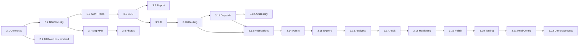

# Campus SOS — Implementation Plan (Phased Antigravity Build)

This plan turns the documentation package into a working product in the order mandated by the master specification (`implementation_sequence`). It is written to be fed to **Antigravity** (agentic build tool) one phase at a time, with human review gates between phases.

## 1. Purpose and Build Approach
- **Documentation first.** The build starts only after this package is accepted. No production application exists yet.
- **One phase = one mission.** Each mission gives the agent the relevant docs, a Definition of Done, and a testing gate. A phase is merged only when its gate passes.
- **Contracts before code.** OpenAPI + event schemas (Phase 0) are the single source for frontend and backend; both are generated/validated from them.
- **No fake production data at any point.** Dev-only mocks are allowed behind `APP_ENV=development`; demo accounts and demo data are created **last**.
- **Source project** (`CampusSOS-master (2).zip`) is consulted for *functionality only*; do not copy UI, visual design, architecture, demo accounts, or fake data.

### 1.1 Inputs the agent must always load
`README.md`, `docs/PRD.md`, the phase's primary docs (listed per phase), and `docs/REQUIREMENTS_TRACEABILITY.md` to tick requirement validation status.

### 1.2 Ground rules for every mission
1. Keep `frontend/` and `backend/` independent; communicate only through `contracts/`.
2. Respect module boundaries in `ARCHITECTURE.md` §3.
3. Write tests with the code; no phase closes without its gate.
4. Every state change writes an audit event.
5. Update `REQUIREMENTS_TRACEABILITY.md` status column when a requirement is implemented and verified.
6. If a requirement is ambiguous, follow the safe rule in `PRD.md` §25 and flag it; never delete the requirement.

## 2. Team Roles for the Build
| Role | Responsibility |
|---|---|
| Product owner (user) | Accept phases, supply future inputs (§8), approve UI |
| Antigravity agents | Implement missions, run tests, produce artifacts |
| Human reviewer/second developer | Code review, security review, UI review |

## 3. Phased Plan (follows the mandated 22-step sequence)

Legend — **Docs:** primary reading; **Gate:** must pass before moving on.

| # | Step (mandated order) | Deliverables | Docs | Depends on | Testing gate |
|---|---|---|---|---|---|
| 3.1 | **Architecture and contracts** | Monorepo skeleton (`frontend/`, `backend/`, `contracts/`, `docs/`); OpenAPI 3.1 from API spec; event JSON schemas; shared Zod schemas; CI pipeline; lint/format; env/config scheme | ARCHITECTURE, API_SPECIFICATION, TECH_STACK | — | OpenAPI lints clean; contract-diff job runs; empty apps build in CI |
| 3.2 | **Database and security model** | Migrations for all tables/enums; triggers (2-photo limit, audit append-only, pin ranges); RLS policies; DB roles; default lookup config (no fake data) | DATABASE_SCHEMA, ARCHITECTURE §7, §13 | 3.1 | Migration up/down tests; RLS tests per role; audit tamper test fails as expected |
| 3.3 | **Authentication and role model** | Login, refresh rotation, MFA, SSO adapter (if available), `/me`, `AccessPolicy`, 12 roles, team membership, incident-level access | API §2–3, ARCHITECTURE §7 | 3.2 | AuthZ matrix tests (every role × endpoint); lockout/rate-limit tests |
| 3.4 | **All role interfaces** | Design system + component library; shell with role router; **all 12 role interfaces** built with mocked adapters and dev-only role switcher; empty/loading/error/offline states | UI_UX_SPECIFICATION §§3–22 | 3.1 (3.3 for real auth) | Storybook states complete; each role interface reachable; no fake data in production build; bundle scan proves role switcher absent in prod |
| 3.5 | **Student Emergency SOS** | Draft API, preview, confirm with idempotency, Emergency Assist flow, confirmation screen, live status screen (realtime + polling), offline queue | PRD §5, API §6, UI §7.2–7.3 | 3.3, 3.4 | E2E: SOS with description only; no incident before confirm; offline queue; AI-down path |
| 3.6 | **Student Report an Incident** | Standard report API + UI; categories; review step; My Reports (Reports/Emergency SOS tabs) | PRD §6, API §7, UI §7.4, §7.6 | 3.5 | E2E on mobile viewport; validation tests |
| 3.7 | **Campus static map and pinning** | Map upload (admin), predefined locations, `CampusMap`/`PinPicker`, normalized coordinate storage, keyboard alternative | PRD §7, API §8, DATABASE §8, UI §4 | 3.2, 3.4 | Pin accuracy test across viewports (same relative position); out-of-range rejection |
| 3.8 | **Photo upload, storage, access** | Presigned upload, validation, EXIF strip, 2-photo limit, signed URL access control, access audit | PRD §8, API §9 | 3.7 | Third photo rejected; non-assigned team/student denied; reporter/admin/assigned allowed; audit `PHOTO_VIEWED` |
| 3.9 | **AI classification** | `AiClassifier` interface, LLM adapter, JSON schema validation, `RuleClassifier`, timeouts, audit | AI_ROUTING §§2–6 | 3.5 | TC-A-001…008; no-identification contract tests |
| 3.10 | **Deterministic routing** | Routing engine, rule store, matrix defaults, union logic, restrictions, dry-run endpoint, versioning | AI_ROUTING §§7–9, 11 | 3.9 | TC-R-001…025; determinism property test |
| 3.11 | **Automatic responder dispatch** | Dispatch engine, offers, timers, parallel offers for SOS, reject/timeout, multi-responder, escalation, watchdog | AI_ROUTING §10, ARCHITECTURE §9 | 3.10 | TC-D-001…007; chaos test: worker restart mid-dispatch |
| 3.12 | **Responder availability** | Duty states, schedules, self/admin toggles, **no inactivity auto-offline** (CHECK constraint + test), responder UI | PRD §12, DATABASE §3.4–3.5 | 3.11 | Idle responder remains Available; transitions audited |
| 3.13 | **Notifications** | Audience resolver, privacy filter, channel planner (in-app, push, SMS, voice, email), delivery receipts, notice drafts + approval, inbox, user toggle | PRD §10, ARCHITECTURE §10, API §10 | 3.10, 3.11 | TC-N-001…007; channel failover tests; deny-list enforcement |
| 3.14 | **Admin incident management** | Overview cards, incident table, **View** (full case file), dispatch board, resolved page, manual assign/reclassify/status, team and responder admin | PRD §13, API §13, UI §8 | 3.10–3.13 | View shows all 20 elements incl. full description; clickable cards navigate correctly |
| 3.15 | **Campus Explore** | Sanitized explore API, map + pins, recent incidents/activity, status filter only | PRD §15, API §14, UI §7.5, ARCHITECTURE §10.4 | 3.7, 3.13 | No urgency UI/API anywhere (static test); restricted incidents absent |
| 3.16 | **Analytics** | T1–T4 metrics, category analytics, response analytics page, materialized views | API §13, PRD A-07, UI §8.9 | 3.14 | Metric correctness vs. fixture timelines; drill-down links |
| 3.17 | **Audit trail** | Audit viewer, case timeline, hash chain, verify, export | PRD §18, API §17 | all | Every required event type produced; chain verify passes; tamper detected |
| 3.18 | **Security/privacy hardening** | Pen-test pass, CSP/headers, rate limits, retention jobs, log redaction, secrets review, restricted-case access auditing | PRD §19, ARCHITECTURE §13 | 3.1–3.17 | ZAP baseline clean; authorization matrix 100 %; privacy checklist |
| 3.19 | **Mobile/responsive polish** | Performance budgets, touch targets, one-hand reach, offline polish, reduced motion, dark mode | UI §5–6 | 3.17 | Lighthouse (mobile) perf ≥ 90, a11y ≥ 95; axe 0 critical; real-device pass on mid-range Android + iPhone |
| 3.20 | **Testing** | Full regression: unit, integration, contract, E2E, resilience (kill AI/SMS/push/worker), load (k6) | TECH_STACK §11 | 3.18, 3.19 | All suites green; SOS survives each single-service failure |
| 3.21 | **Real campus/team configuration** | Import real map, predefined locations, teams, members, responders, duty status, hotlines, routing policies via admin settings/CLI | PRD §24, UI §8.12 | 3.20 + user inputs (§8) | Config dry-run; routing test pack re-run with real policies |
| 3.22 | **Demo accounts and demo data — last** | Create approved real/demo accounts; optional clearly-labelled demo incidents in a **non-production** environment only | PRD §21 | 3.21 | Demo data flagged `is_demo`, excluded from production analytics; production contains no fake data |

## 4. Milestones and Dependency Graph



| Milestone | Included steps | Outcome |
|---|---|---|
| M0 Foundations | 3.1–3.3 | Contracts, schema, auth, roles |
| M1 Interfaces | 3.4 | All 12 role UIs reviewable with mocks |
| M2 Reporting | 3.5–3.8 | Students can report SOS/incident with pin and photos |
| M3 Intelligence & Response | 3.9–3.13 | Classification, routing, dispatch, availability, notifications live |
| M4 Operations | 3.14–3.17 | Admin console, Explore, analytics, audit |
| M5 Release candidate | 3.18–3.20 | Hardened, polished, fully tested |
| M6 Go-live | 3.21–3.22 | Real configuration; accounts last |

## 5. Testing Gates and Final Validation Checklist
Each phase gate (§3) is mandatory. Before packaging a release, the 29 final-validation items from the master spec are re-verified against the **built product** (not only the docs) and recorded in `REQUIREMENTS_TRACEABILITY.md` (`REQ-G-023.01–.29`). A release candidate requires:
- All requirement IDs `Implemented & Verified` or explicitly `Deferred (approved)`.
- Resilience suite green (AI down, SMS down, push down, worker down, one responder rejecting, whole team unavailable).
- Privacy suite green (restricted cases never in Explore/campus-wide; photo access matrix; directory has no students).
- Static checks: no urgency filter strings, no fake-data seeds, no dev role switcher in production bundle, no copied legacy assets.

## 6. Antigravity Working Instructions

### 6.1 Mission prompt template
```
MISSION: <Phase id and name from IMPLEMENTATION_PLAN §3>
CONTEXT FILES: README.md, docs/PRD.md, docs/<primary docs>, docs/REQUIREMENTS_TRACEABILITY.md
SCOPE: Implement only this phase. Do not start later phases.
CONSTRAINTS: frontend/backend separation; module boundaries; no fake production data;
  do not reuse the previous project's UI/design/architecture/data; follow PRD §25 safe rules.
DEFINITION OF DONE: deliverables in the phase table + tests in the Gate column pass.
OUTPUT ARTIFACTS: task list, implementation plan, code, test report, screenshots (for UI phases),
  updated traceability statuses, short "decisions & deviations" note.
STOP AND ASK IF: a requirement conflicts, a future input (PRD §24) is needed, or a safe rule needs college confirmation.
```

### 6.2 Review artifacts to request
- UI phases: screenshots/recordings at 360 px, 768 px, 1280 px; Storybook link; accessibility report.
- Backend phases: OpenAPI diff, test report, migration summary, authorization matrix output.
- Intelligence phases: test-pack results (TC IDs), fallback demonstration, audit samples **from test data only**.

### 6.3 Parallelization guidance
Safe to run in parallel after 3.1: (3.2 → 3.3) with 3.4; 3.7 with 3.5. Do **not** parallelize 3.9–3.13 (shared contracts and event flows).

## 7. Integration and UI Review
- **Integration checkpoints:** end of M1 (UI against mocks), end of M2 (UI against real API), end of M3 (end-to-end SOS drill with sandbox providers), end of M4 (admin operations walkthrough).
- **UI review loop:** at M1 and M2 review each role interface against `UI_UX_SPECIFICATION.md`: hierarchy, spacing, typography, states, mobile-first behaviour, absence of removed elements (urgency filter, response protocol, AI marketing, generic Live Campus Dispatch).
- **Drill:** scripted SOS drills (flagged `is_drill`) every release; measure T1–T3.

## 8. Final Account Phase — Required Future Inputs
Provided by the user before step 3.21:
1. Actual college 2D campus map image.
2. Campus SOS team member names.
3. Administrator details.
4. Responder details.
5. Department/team assignments.
6. Duty schedules.
7. Emergency hotline numbers.
8. Final college routing policies.
9. Final demo account list.

Account creation checklist (3.22): create admin(s) → teams and members → responders and duty states → student onboarding method (SSO/email) → verify MFA for non-students → smoke test each role → record in audit.

## 9. Risks and Mitigations
| Risk | Mitigation |
|---|---|
| Notification provider onboarding delays (SMS sender registration) | Start provider registration at M0; push + in-app work without it |
| AI misclassification | Rule fallback, union routing, admin reclassify, evaluation harness |
| False alarms | Flagging and review, confirm step, no student-set priority |
| Privacy leak of restricted cases | RLS + field filtering + deny list + audited reveals + privacy test suite |
| Scope creep | Traceability matrix is the scope contract |
| Map image quality/scale | Admin map upload validation; pinch-zoom; keyboard nudge |
| Single point of failure in worker | Watchdog, outbox polling fallback, manual dispatch page |

## 10. Definition of Done (Release)
All 22 steps complete; all gates green; requirement matrix complete; final-validation list satisfied; real configuration loaded; accounts created last; production contains no fake data.
